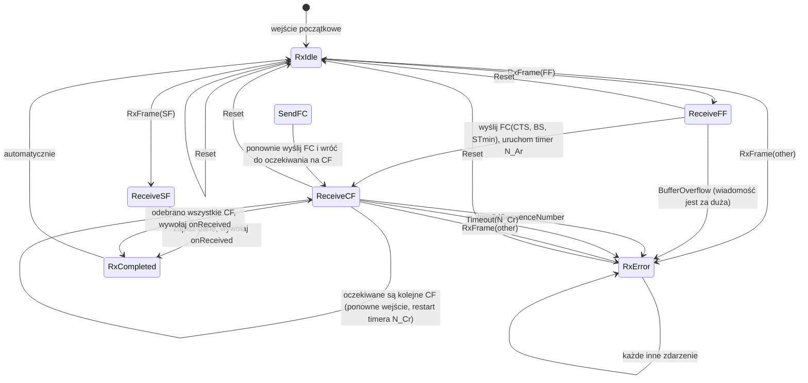

# Automat stanów odbiornika ISO-TP (HFSM2)

## Stany automatu odbiornika

| Stan | Opis |
|---|---|
| `RxIdle` | Oczekiwanie na pierwszą ramkę (SF lub FF). |
| `ReceiveSF` | Odebrano SF — natychmiast wywoływane jest `onReceived`. |
| `ReceiveFF` | Odebrano FF — wysyłana jest ramka FC i rozpoczyna się składanie wiadomości. |
| `SendFC` | Ponowne wysłanie Flow Control, jeśli jest to wymagane. |
| `ReceiveCF` | Oczekiwanie na kolejne ramki Consecutive Frame (CF) i ich składanie. |
| `RxCompleted` | Wiadomość została w całości złożona. |
| `RxError` | Stan błędu, np. błąd protokołu lub przekroczenie limitu czasu. |

## Diagram przejść

## Legenda zdarzeń

| Zdarzenie | Opis |
|---|---|
| `RxFrame(SF)` | Odebrano Single Frame (ramkę pojedynczą). |
| `RxFrame(FF)` | Odebrano First Frame (ramkę pierwszą). |
| `RxFrame(CF)` | Odebrano Consecutive Frame (ramkę kolejną). |
| `Timeout(N_Ar)` | Upłynął czas oczekiwania na pierwszą ramkę CF. |
| `Timeout(N_Cr)` | Upłynął dopuszczalny odstęp czasu między ramkami CF. |
| `Reset` | Użytkownik wywołuje `reset()`. |
