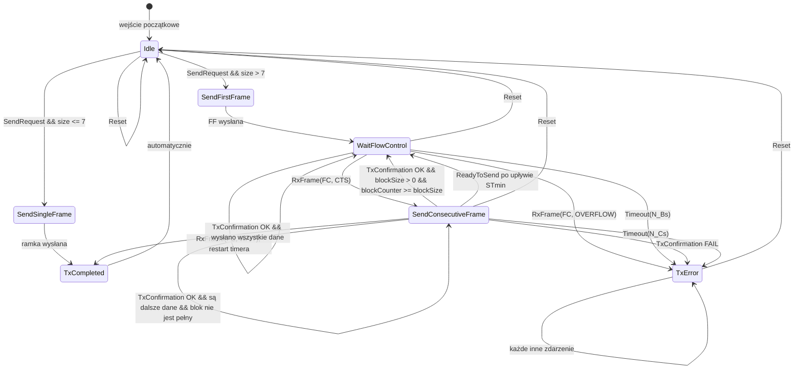

# Automat stanów nadajnika ISO-TP (HFSM2)

## Stany automatu nadajnika

| Stan | Opis |
|---|---|
| `Idle` | Oczekiwanie na polecenie wysłania. |
| `SendSingleFrame` | Wysłanie SF — krótkiej wiadomości o długości do 7 bajtów. |
| `SendFirstFrame` | Wysłanie FF — pierwszej ramki długiej wiadomości. |
| `WaitFlowControl` | Oczekiwanie na FC od odbiorcy. |
| `SendConsecutiveFrame` | Wysłanie kolejnej ramki CF z uwzględnieniem BlockSize i STmin. |
| `TxCompleted` | Wysyłanie zakończone powodzeniem. |
| `TxError` | Stan błędu, np. przekroczenie limitu czasu, wyjątek lub nieprawidłowa FC. |

## Diagram przejść

## Legenda zdarzeń

| Zdarzenie | Opis |
|---|---|
| `SendRequest` | Użytkownik wywołuje `send()`. |
| `RxFrame(FC)` | Odebrano ramkę Flow Control (CTS, WAIT lub OVERFLOW). |
| `TxConfirmation` | Potwierdzenie wysłania ramki CAN (powodzenie/błąd). |
| `Timeout(N_Bs)` | Upłynął czas oczekiwania na FC. |
| `Timeout(N_Cs)` | Upłynął czas między ramkami CF zgodnie z STmin. |
| `ReadyToSend` | Wewnętrzne zdarzenie generowane po przerwie STmin. |
| `Reset` | Użytkownik wywołuje `reset()`. |
