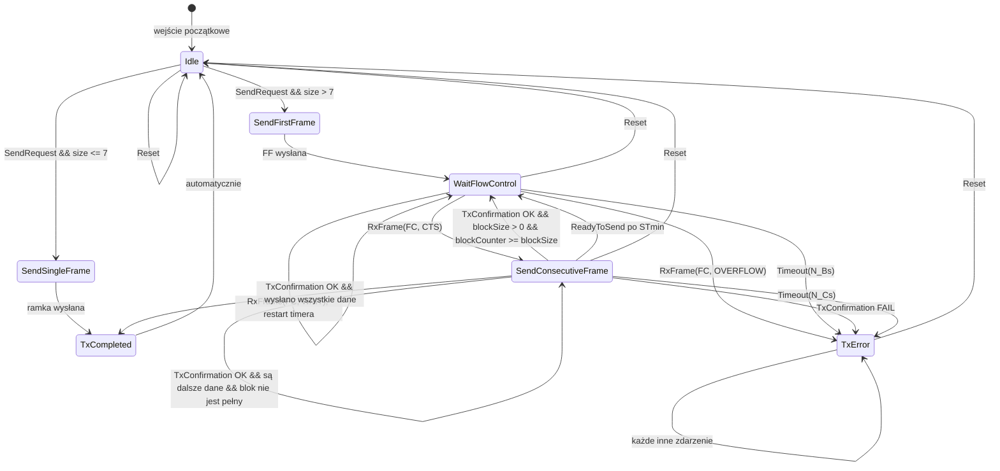
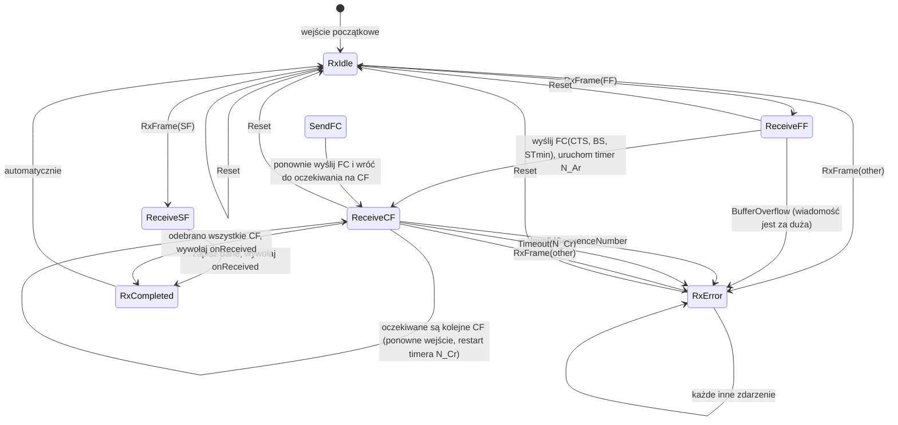

# Specyfikacja implementacji protokołu ISO-TP (szkic — niezaimplementowane)

> **Status:** szkic. Implementacja nie znajduje się obecnie w bazie kodu. Obsługę ISO-TP realizuje sprzętowo urządzenie J2534 (filtry, segmentacja i składanie wiadomości). Ten dokument stanowi podstawę do przyszłej implementacji programowej w adapterach ELM327/ESP32/STM32.

## Cel

Stworzyć rozszerzalną implementację protokołu ISO-TP, umożliwiającą korzystanie z różnych sterowników do wysyłania i odbierania wiadomości CAN.

## Wymagania funkcjonalne

- Wysyłanie wiadomości przez magistralę CAN.
- Odbieranie wiadomości z magistrali CAN.
- Obsługa odbioru i transmisji długich wiadomości.

## Wymagania niefunkcjonalne

- Obsługa identyfikatorów CAN 11- i 29-bitowych.
- Obsługa adresowania mieszanego (mixed addressing).
- Maksymalny rozmiar ładunku pojedynczej ramki: 8 bajtów.
- Obsługa wszystkich typów N_PCI.
- Konfigurowalne limity czasu N_As, N_Ar, N_Bs, N_Br, N_Cs i N_Cr z typowymi wartościami domyślnymi.
- Wykorzystanie automatów stanów do implementacji logiki.
- Wykorzystanie biblioteki HFSM2 w C++17.
- Oddzielenie wysyłania danych na magistralę od logiki przetwarzania strumienia wiadomości.
- Wykorzystanie zdarzeń zamiast odpytywania (polling).
- Obsługa wyjątków zgłaszanych przez sterowniki.
- Implementacja zgodna ze standardem C++17.
- Po wyjątku sterownika przejście do stanu błędu, z którego można wyjść przez funkcję `reset`. Powiadomienie użytkownika przez callback `onError`.
- Konfiguracja szybkości transmisji i filtrów odbywa się zewnętrznie.
- Timery powinny korzystać z interfejsu; należy zaimplementować jego wersję dla Windows.
- Osobne automaty stanów dla nadawania i odbioru.
- Maksymalna długość wiadomości: 4095 bajtów.
- Obsługa utraty ramek i błędnej kolejności.
- Po odebraniu kompletnej wiadomości wywołanie callbacku `onReceived`.
- Protokół otrzymuje skonfigurowany sterownik z ustawionymi filtrami.
- Obsługa równoległego wysyłania wiadomości z różnymi identyfikatorami CAN.

## Diagramy automatów stanów

### Nadajnik (Tx)

| Stan | Opis |
|---|---|
| `Idle` | Oczekiwanie na polecenie wysłania. |
| `SendSingleFrame` | Wysłanie SF — krótkiej wiadomości o długości do 7 bajtów. |
| `SendFirstFrame` | Wysłanie FF — pierwszej ramki długiej wiadomości. |
| `WaitFlowControl` | Oczekiwanie na FC od odbiorcy po FF lub po wysłaniu bloku CF. |
| `SendConsecutiveFrame` | Wysłanie kolejnej ramki CF z uwzględnieniem BlockSize i STmin. |
| `TxCompleted` | Wysyłanie zakończone powodzeniem; automatyczne przejście do `Idle`. |
| `TxError` | Stan błędu: przekroczenie limitu czasu, wyjątek sterownika lub nieprawidłowa FC. |



### Odbiornik (Rx)

| Stan | Opis |
|---|---|
| `RxIdle` | Oczekiwanie na pierwszą ramkę SF lub FF. |
| `ReceiveSF` | Odebrano SF — dane są od razu zapisywane i wywoływany jest `onReceived`. |
| `ReceiveFF` | Odebrano FF — wysyłana jest FC(CTS, BS, STmin) i uruchamiany jest timer N_Ar. |
| `SendFC` | Ponowne wysłanie Flow Control, jeśli jest wymagane. |
| `ReceiveCF` | Oczekiwanie na kolejne ramki CF i ich składanie, z kontrolą SN oraz limitem czasu N_Cr. |
| `RxCompleted` | Odebrano wszystkie CF, wywołano `onReceived`; automatyczne przejście do `Idle`. |
| `RxError` | Stan błędu: nieprawidłowy SN, przekroczenie limitu czasu lub przepełnienie bufora. |



## Architektura sesji

Aby obsługiwać równoległe wysyłanie wiadomości z różnymi identyfikatorami CAN, wprowadzono **menedżer sesji** `IsoTpSessionManager`. Każde unikalne połączenie (para TxCANId/RxCANId) jest reprezentowane przez osobną **sesję** `IsoTpSession`.

### Komponenty

- **`IsoTpSession`** zawiera:
  - Dwa automaty stanów: TxFSM i RxFSM.
  - Identyfikatory CAN (`txId`, `rxId`).
  - Lokalne timery (m.in. limity N_Bs, N_Cr i N_Ar).
  - Callbacki `onReceived` i `onError` przypisane do sesji.
  - Opcjonalną kolejkę wiadomości wychodzących.

- **`IsoTpSessionManager`** zarządza sesjami:
  - Pozwala tworzyć i usuwać sesje według identyfikatora (`uint16 sessionId`).
  - Po otrzymaniu ramki CAN od sterownika ustala jej sesję na podstawie pola `canId` i przekazuje ją do `handleRxFrame()` właściwej sesji.
  - Udostępnia metodę `send(canId, data)`, która wyszukuje sesję według `txId` lub `rxId`.
  - Zapewnia bezpieczeństwo współbieżne listy sesji za pomocą `std::shared_mutex`.

### Diagram architektury

```
+---------------------+
|   Application       |
+---------+-----------+
          |
          v
+---------+-----------+
| IsoTpSessionManager |
+---------+-----------+
          |
     +----+----+
     |         |
     v         v
+---------+ +---------+
| Session | | Session | ...
| tx=0x7DF| | tx=0x733|
| rx=0x7E8| | rx=0x759|
+---------+ +---------+
     |         |
     +----+----+
          |
          v
+----------------------+
| ICanDriver (shared)  |
+----------------------+
```

### API użytkownika

```cpp
// Pobierz instancję menedżera (singleton)
auto& manager = IsoTpSessionManager::instance();
manager.setDriver(&canDriver);

// Utwórz sesję
uint16_t sid = manager.createSession(
    0x7E0,                                     // txId (żądanie)
    0x7E8,                                     // rxId (odpowiedź)
    [](const std::vector<uint8_t>& msg) { /* onReceived */ },
    [](ErrorCode ec) { /* onError */ }
);

// Wyślij dane w ramach sesji
manager.send(0x7E0, {0x01, 0x02, 0x03});       // wyszukanie sesji według txId

// Usuń sesję
manager.destroySession(sid);
```

### Identyfikacja ramek przychodzących

Po odebraniu ramki CAN menedżer przegląda aktywne sesje i przekazuje ramkę do tej, dla której `rxId == canId`. Jeśli nie znajdzie pasującej sesji, ramka zostaje zignorowana albo wywoływany jest globalny handler `onUnhandledFrame`.

### Bezpieczeństwo współbieżne

- Każda sesja używa własnego `std::mutex` do ochrony automatów stanów i timerów.
- Menedżer używa `std::shared_mutex`: odczyt podczas wyszukiwania sesji i zapis podczas ich tworzenia lub usuwania.

### Timery

Każda sesja ma własną instancję `ITimer`. Limity czasu N_Bs, N_Cr i przerwy STmin są konfigurowane osobno przez `IsoTpConfig`, przekazywany podczas tworzenia sesji.

### Ograniczenia

- Wszystkie sesje korzystają z jednego sterownika i wspólnej magistrali CAN.
- Filtry CAN (sprzętowe) muszą obejmować wszystkie identyfikatory `rxId` aktywnych sesji. Konfiguracja filtrów odbywa się zewnętrznie przy tworzeniu i usuwaniu sesji.
- Długotrwała transmisja blokuje jedynie własną sesję i nie powinna wpływać na pozostałe.

## Testowanie

- Pokryć testami jednostkowymi scenariusze wysyłania i odbioru z użyciem sterowników pozorowanych (mock).
- Przetestować wysyłanie i odbiór długiej wiadomości.
- Przetestować przekroczenie limitu czasu między ramkami CAN.
- Przetestować próbę wysłania kolejnej wiadomości przed odebraniem Flow Control.
- Przetestować nadejście nowej First Frame przed zakończeniem poprzedniej sesji.
- Przetestować utratę ramki.
- Przetestować nieprawidłowy licznik ramek SN.
- Przetestować równoczesne wysyłanie w dwóch różnych sesjach.
- Przetestować odbiór wiadomości w jednej sesji podczas aktywnego nadawania w drugiej.
- Przetestować tworzenie i usuwanie sesji podczas transmisji danych.
