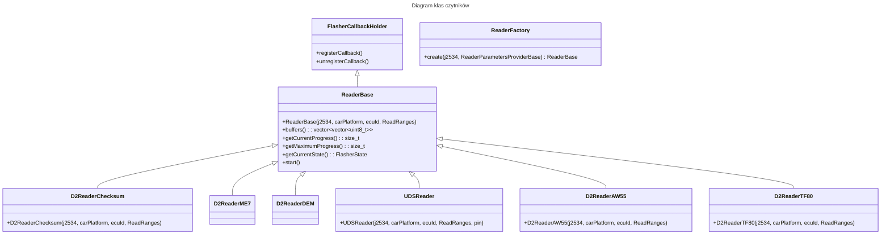

# Specyfikacja: odczyt oprogramowania z ECU

## 1. Cel

Odczytywanie oprogramowania różnych sterowników ECU przez wspólny interfejs obsługujący protokoły D2 i UDS.

## 2. Architektura

### 2.1. Diagram klas



### 2.2. ReaderBase

Klasa bazowa wszystkich czytników. Dziedziczy po `FlasherCallbackHolder` i enkapsuluje wątek, postęp, stan oraz bufory.

```cpp
class ReaderBase: public FlasherCallbackHolder {
public:
    ReaderBase(j2534::J2534& j2534, common::CarPlatform carPlatform,
               uint32_t ecuId, ReadRanges ranges);
    virtual ~ReaderBase();

    FlasherState getCurrentState() const;
    size_t getCurrentProgress() const;
    size_t getMaximumProgress() const;
    const std::vector<std::vector<uint8_t>>& buffers() const;
    void start();

protected:
    virtual void startImpl(std::vector<std::unique_ptr<ICanChannel>>& channels) = 0;
    void setCurrentState(FlasherState state);
    void incCurrentProgress(size_t delta);
    void setMaximumProgress(size_t maxProgress);

    const common::CarPlatform _carPlatform;
    const uint32_t _ecuId;
    const ReadRanges _ranges;
    common::J2534ChannelProvider _channelProvider;
    std::vector<std::vector<uint8_t>> _buffers;
};
```

**Najważniejsze zmiany:**
- `ReadRanges` to wektor elementów `ReadRange`, umożliwiający obsługę wielu zakresów.
- `_buffers` to wektor buforów — po jednym dla każdego zakresu.
- `buffers()` zwraca `vector<vector<uint8_t>>`.

### 2.3. D2ReaderChecksum

Odczyt przez protokół D2 z wykorzystaniem sumy kontrolnej. Używa `D2FlasherImpl` — wspólnego automatu HFSM2 z `D2FlasherBase`:
- Przekazuje pusty callback kasowania (no-op).
- W callbacku zapisu wykonuje odczyt bajt po bajcie: `jumpTo(addr)` → żądanie sumy kontrolnej → odczyt bajtu.
- Nie wymaga bootloadera; przekazuje pusty `VBF()`.

**Pliki:** `Flasher/flasher/D2ReaderChecksum.hpp`, `Flasher/src/D2ReaderChecksum.cpp`.

### 2.4. UDSReader

Odczyt przez protokół UDS (ISO 15765). Korzysta z usługi `0x23` (`ReadMemoryByAddress`) i odczytuje dane blokami po `0x100` bajtów. Obsługiwane platformy: P3, Ford_UDS, VAG i Haval_UDS. Wymaga PIN-u do autoryzacji.

**Pliki:** `Flasher/flasher/UDSReader.hpp`, `Flasher/src/UDSReader.cpp`.

### 2.5. D2ReaderAW55

Wyspecjalizowany czytnik automatycznej skrzyni biegów AW55-50SN. Używa `D2Messages::createReadDataByOffsetMsg()`.

**Pliki:** `Flasher/flasher/D2ReaderAW55.hpp`, `Flasher/src/D2ReaderAW55.cpp`.

### 2.6. D2ReaderTF80

Wyspecjalizowany czytnik automatycznej skrzyni biegów TF-80SC. Używa `D2Messages::createReadTCMTF80DataByAddr()`.

Dane są odczytywane porcjami po 132 bajty. **requestId = `{0xB4, 0x21, 0x34, addr(4)}` (8 bajtów)** — żądanie obejmuje dwie ramki, a echo odpowiedzi (9 bajtów) wykracza poza pierwszą ramkę CAN. Jest ono składane przez parser `D2Request::process` z kolejnych ramek serii (zob. `d2_protocol_implementation.md`, sekcja „Format odpowiedzi”). Pełne echo jest weryfikowane i usuwane przez parser, więc payload odpowiedzi zawiera już same dane. Ręczne przesunięcie (`additionalShift = 4`) nie jest potrzebne i zostało usunięte.

Zabezpieczenie pętli odczytu: pusta odpowiedź powoduje `std::runtime_error` (w przeciwnym razie `j += 0` mogłoby utworzyć nieskończoną pętlę). Liczba wstawianych bajtów jest ograniczona do `min(requestSize, response.size())`.

**Pliki:** `Flasher/flasher/D2ReaderTF80.hpp`, `Flasher/src/D2ReaderTF80.cpp`.

### 2.7. ReaderFactory

Fabryka przyjmuje `ReaderParametersProviderBase` i wybiera implementację na podstawie krotki `(carPlatform, ecuId, cmInfo)`:

```cpp
// Flasher/src/ReaderFactory.cpp
std::unique_ptr<ReaderBase> ReaderFactory::create(
    j2534::J2534& j2534,
    const ReaderParametersProviderBase& p)
{
    const auto platform = p.getCarPlatform();
    const auto ecuId = p.getEcuId();
    const auto& cmInfo = p.getCmInfo();
    const auto ranges = p.getReadRanges();

    if (isD2Platform(platform)) {
        if (ecuId == to_underlying(common::D2ECUType::ECM_ME))
            return std::make_unique<D2ReaderME7>(j2534, platform, ecuId, ranges, bootloader);
        if (ecuId == to_underlying(common::D2ECUType::DEM))
            return std::make_unique<D2ReaderDEM>(j2534, platform, ecuId, ranges, bootloader);
        if (ecuId == to_underlying(common::D2ECUType::TCM)) {
            if (cmInfo == "aw55_p2")  return D2ReaderAW55(...);
            if (cmInfo == "tf80_p2") return D2ReaderTF80(...);
        }
        return std::make_unique<D2ReaderChecksum>(j2534, platform, ecuId, ranges);
    }
    if (isUDSPlatform(platform)) {
        auto auth = p.getAuthParams();
        if (!auth) throw ...;
        return std::make_unique<UDSReader>(j2534, platform, ecuId, ranges, auth->pin);
    }
    throw std::runtime_error("Unsupported platform/ECU for reading");
}
```

**Uwaga:** `D2ReaderME7` i `D2ReaderDEM` wymagają parametrów bootloadera (`getBootloaderParams()`), w przeciwieństwie do `D2ReaderChecksum`.

### 2.8. D2ReaderME7

Odczyt sterownika ECM_ME przez protokół D2. Używa `D2FlasherImpl` — wspólnego automatu HFSM2 z `D2FlasherBase`:
- Przekazuje pusty callback kasowania (no-op).
- W callbacku zapisu odczytuje dane bajt po bajcie: `createReadOffsetMsg2(addr)` → wysłanie/odbiór → wyodrębnienie bajtu z odpowiedzi.
- Wymaga bootloadera (SBL), aby przejść do trybu programowania.

**Pliki:** `Flasher/flasher/D2ReaderME7.hpp`, `Flasher/src/D2ReaderME7.cpp`.

### 2.9. D2ReaderDEM

Odczyt sterownika DEM przez protokół D2. Działa podobnie do `D2ReaderME7`:
- Używa `createReadOffsetMsgDEM` do tworzenia żądań.
- Wymaga bootloadera.

**Pliki:** `Flasher/flasher/D2ReaderDEM.hpp`, `Flasher/src/D2ReaderDEM.cpp`.

### 2.10. CLI — readFlash przez ReaderFactory

W pliku `VolvoFlasher.cpp` tworzony jest lokalny obiekt `CLIReaderProvider`, a następnie wywoływane jest `ReaderFactory::create()`:

```
CLIReaderProvider provider(carPlatform, ecuId, cmInfo, ranges, pin);
auto reader = ReaderFactory::create(j2534, provider);
reader->start();
// ... oczekiwanie na stan Done
output.write(reader->buffers()[0].data(), ...);
```

## 3. Pliki

### 3.1. Nowe pliki

| Nr | Plik | Opis |
|---|---|---|
| 1 | `Flasher/flasher/ParamsTypes.hpp` | `ReadRange`, `ReadRanges`, `AuthorizationParams`, `BootloaderParams` |
| 2 | `Flasher/flasher/ReaderParametersProviderBase.hpp` | Klasa bazowa dostawcy parametrów |
| 3 | `Flasher/flasher/FlasherCallbackHolder.hpp` | Klasa bazowa przechowująca callbacki |
| 4 | `Flasher/flasher/ReaderBase.hpp` | Abstrakcyjna klasa bazowa czytnika (`ReadRanges`) |
| 5 | `Flasher/src/ReaderBase.cpp` | Implementacja |
| 6 | `Flasher/flasher/ReaderFactory.hpp` | Fabryka czytników |
| 7 | `Flasher/src/ReaderFactory.cpp` | Implementacja fabryki |
| 8 | `Flasher/flasher/D2ReaderChecksum.hpp` | Odczyt D2 przez sumę kontrolną (domyślnie ECU 0x7A) |
| 9 | `Flasher/src/D2ReaderChecksum.cpp` | Używa D2FlasherImpl, bez bootloadera |
| 10 | `Flasher/flasher/D2ReaderME7.hpp` | Odczyt D2 ECM_ME przez createReadOffsetMsg2 |
| 11 | `Flasher/src/D2ReaderME7.cpp` | Używa D2FlasherImpl, wymaga bootloadera |
| 12 | `Flasher/flasher/D2ReaderDEM.hpp` | Odczyt D2 DEM przez createReadOffsetMsgDEM |
| 13 | `Flasher/src/D2ReaderDEM.cpp` | Używa D2FlasherImpl, wymaga bootloadera |
| 14 | `Flasher/flasher/UDSReader.hpp` | Czytnik UDS przez usługę 0x23 |
| 15 | `Flasher/src/UDSReader.cpp` | Implementacja |
| 16 | `Flasher/flasher/D2ReaderAW55.hpp` | Czytnik AW55 TCM |
| 17 | `Flasher/src/D2ReaderAW55.cpp` | Implementacja |
| 18 | `Flasher/flasher/D2ReaderTF80.hpp` | Czytnik TF80 TCM |
| 19 | `Flasher/src/D2ReaderTF80.cpp` | Implementacja |

### 3.2. Zmienione lub usunięte pliki

| Nr | Plik | Zmiana |
|---|---|---|
| 20 | `Flasher/src/D2FlasherImpl.hpp` | **Nowy** — HFSM2 i kroki D2 wspólne dla FlasherBase i czytników |
| 21 | `Flasher/src/D2FlasherImpl.cpp` | **Nowy** — implementacja |
| 22 | `VolvoFlasher/src/VolvoFlasher.cpp` | `readFlash()` przepisano tak, aby korzystał z ReaderFactory |
| 23 | `Flasher/flasher/D2Reader.hpp` | **Usunięty** i zastąpiony przez D2ReaderChecksum |
| 24 | `Flasher/src/D2Reader.cpp` | **Usunięty** i zastąpiony przez D2ReaderChecksum |
| 25 | `Flasher/flasher/UDSMemoryReader.hpp` | **Później usunięty**; zastąpiony przez `UDSReaderMemory` (MemoryReaderFactory) |
| 26 | `Flasher/src/UDSMemoryReader.cpp` | **Później usunięty**; zastąpiony przez `UDSReaderMemory` (MemoryReaderFactory) |

## 4. D2FlasherImpl — wspólny automat HFSM2

`D2FlasherImpl` znajduje się w plikach `Flasher/src/D2FlasherImpl.{hpp,cpp}`. Zawiera:
- Automat HFSM2 (11 stanów: FallAsleep → StartPBL → LoadSBL → StartSBL → Erase → Write → WakeUpFinish → SetDIMTime → Done/Error).
- Metodę `run()`, która uruchamia FSM i czeka na Done/Error.
- Callbacki `eraseCallback` i `writeCallback`.

Zastosowanie:
- `D2FlasherBase` → kasowanie i zapis (programowanie).
- `D2ReaderChecksum` → brak kasowania, odczyt bajt po bajcie przez sumę kontrolną.
- `D2ReaderME7` → brak kasowania, odczyt bajt po bajcie przez `createReadOffsetMsg2`.
- `D2ReaderDEM` → brak kasowania, odczyt bajt po bajcie przez `createReadOffsetMsgDEM`.

## 5. Komponenty odłożone na później

| Komponent | Powód |
|---|---|
| `D2ReaderReadMemoryByAddr` | Odczyt przez 0xA6 w blokach nie został zaimplementowany; `D2ReaderChecksum` wykonuje odczyt bajt po bajcie. |

## 5.1. MemoryReaderFactory — odczyt pamięci bez autoryzacji (dodany później)

Równoległa hierarchia czytników, które nie wymagają bootloadera ani autoryzacji:

```
MemoryReaderFactory
  ├── D2ReaderME7Memory   (D2, ECM_ME: createReadDataByAddrMsg {0xBB}, adres 3-bajtowy)
  ├── UDSReaderMemory     (UDS 0x23, bloki po 0x100 bajtów)
  └── D2ReaderAW55 / D2ReaderTF80 (współdzielone z ReaderFactory)
```

**Pliki:** `Flasher/flasher/MemoryReaderFactory.hpp`, `Flasher/src/MemoryReaderFactory.cpp`, `Flasher/flasher/D2ReaderME7Memory.hpp`, `Flasher/flasher/UDSReaderMemory.hpp`.

**`MemoryReaderFactory::getSupportedEcus(platform)`** zwraca listę sterowników ECU obsługujących odczyt pamięci:
- `P80`, `P2`, `P2_250`, `P2_UDS` → `{0x7A, 0x6E}`.

Funkcje `isD2Platform()` i `isUDSPlatform()` przeniesiono do wspólnych plików `Flasher/src/Util.{hpp,cpp}`; są używane przez ReaderFactory i MemoryReaderFactory.

## 6. Kryteria ukończenia

1. ✓ `ReaderBase` jest wspólną klasą bazową i zawiera `ReadRanges`, `_buffers` oraz `FlasherCallbackHolder`.
2. ✓ `D2ReaderChecksum` odczytuje bajt po bajcie przez sumę kontrolną i używa D2FlasherImpl.
3. ✓ `D2ReaderME7` odczytuje ECM_ME przez `createReadOffsetMsg2` i używa D2FlasherImpl.
4. ✓ `D2ReaderDEM` odczytuje DEM przez `createReadOffsetMsgDEM` i używa D2FlasherImpl.
5. ✓ `UDSReader` odczytuje dane na platformach UDS przez usługę 0x23, blokami.
6. ✓ `D2ReaderAW55` i `D2ReaderTF80` odczytują TCM.
7. ✓ `ReaderFactory::create()` wybiera implementację na podstawie `(platform, ecuId, cmInfo)`.
8. ✓ Polecenie `read` programu VolvoFlasher używa ReaderFactory.
9. ✓ Stary `D2Reader` usunięto; `UDSMemoryReader` usunięto i zastąpiono przez `UDSReaderMemory`.
10. ✓ `MemoryReaderFactory::create()` wybiera implementację na podstawie `(platform, ecuId, cmInfo)`.
11. ✓ `MemoryReaderFactory::getSupportedEcus()` zwraca listę sterowników możliwych do odczytu dla danej platformy.
12. ✓ Kompilacja `cmake --build build --config Release` kończy się bez błędów.
